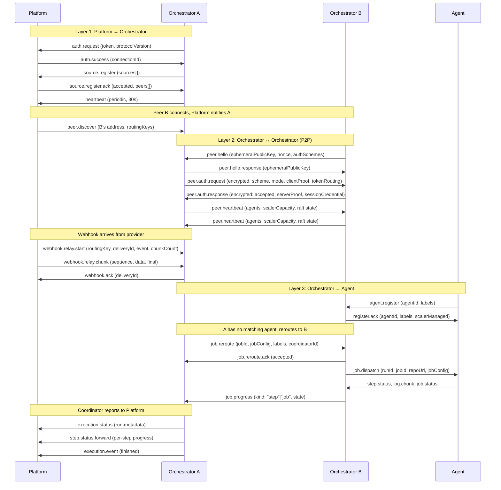

## Message flow overview

The following diagram shows the typical happy-path message flow across both WebSocket layers, from connection setup through webhook relay to job completion.

## Common messages

These messages are shared across both WebSocket layers.

> Authoritative source: `packages/engine/src/protocol/messages/common.ts`

### heartbeat

Sent periodically to keep the WebSocket connection alive. Both orchestrators (to Platform) and agents (to orchestrators) send heartbeats on a 30-second interval.

| Field     | Type          | Required | Description                   |
| --------- | ------------- | -------- | ----------------------------- |
| type      | `"heartbeat"` | Yes      | Message discriminator         |
| timestamp | number        | Yes      | Unix timestamp (milliseconds) |

> Authoritative source: `packages/engine/src/protocol/messages/common.ts` -- `heartbeatSchema`

### ack

Positive acknowledgment of a received message. Used for generic message-level acknowledgments.

| Field     | Type    | Required | Description                          |
| --------- | ------- | -------- | ------------------------------------ |
| type      | `"ack"` | Yes      | Message discriminator                |
| messageId | string  | Yes      | ID of the message being acknowledged |

> Authoritative source: `packages/engine/src/protocol/messages/common.ts` -- `ackSchema`

### nack

Negative acknowledgment -- the message was received but could not be processed. Also the **version-skew diagnosability** signal: when a peer receives a message type it does not understand (the other side is running a newer build), it replies with a NACK naming the unsupported type instead of silently dropping the frame. Without this, an unknown type surfaces only as a downstream proxy timeout; the NACK turns it into an explicit, logged, upgrade-actionable error. `nack` is a member of both the Platform-to-orchestrator and orchestrator-to-Platform unions -- either side can NACK the other.

| Field        | Type     | Required | Description                                                                                                                                                                                                 |
| ------------ | -------- | -------- | ----------------------------------------------------------------------------------------------------------------------------------------------------------------------------------------------------------- |
| type         | `"nack"` | Yes      | Message discriminator                                                                                                                                                                                       |
| messageId    | string   | No       | ID of the offending frame, echoed when it carried one (correlation)                                                                                                                                         |
| code         | enum     | No       | One of: `unsupported_type` (the receiver does not know the frame's `type`: version skew), `invalid_frame` (the receiver knows the `type` but dropped the frame as invalid). Absent means `unsupported_type` |
| receivedType | string   | No       | The message type that triggered the NACK                                                                                                                                                                    |
| reason       | string   | Yes      | Human-readable rejection reason, including an upgrade hint                                                                                                                                                  |

**Behavior on an unknown frame:** the receiver first runs its normal recognition schemas. Only a frame that fails them all AND carries a `type` this build does not recognize is NACKed as version skew. The connection stays open -- a single unknown frame from an ahead-running peer must not tear down the whole link. The receiver tells version skew from malformation with a recognized-type set derived from the schema discriminators. Two classes are exempt and stay drop-and-warn: a `nack` itself (loop guard -- a NACK is never NACKed) and pure streaming frames (`log.chunk` / `orch-log.chunk`, which cannot be correlated).

**Behavior on an invalid frame of a known type:** a frame whose `type` is recognized but still fails validation is malformed, not skewed. The Platform drops it and logs `Invalid orchestrator frame dropped` with the message type and the failing field paths, never the field values. When the frame carries a `messageId`, the Platform answers with a `nack` whose `code` is `invalid_frame` and whose `reason` names the failing fields. The connection stays open until it sends five invalid frames within 60 seconds; the Platform then closes it with code 4003. A frame that is not JSON, or has no `type` field, still closes the connection at once. The orchestrator drops an invalid Platform frame with a warning and keeps its uplink open.

> Authoritative source: `packages/engine/src/protocol/messages/common.ts` -- `nackSchema`, `buildUnsupportedMessageNack`

### error

Protocol-level error notification. Sent when something goes wrong at the connection level.

| Field   | Type      | Required | Description                  |
| ------- | --------- | -------- | ---------------------------- |
| type    | `"error"` | Yes      | Message discriminator        |
| code    | string    | Yes      | Error code identifier        |
| message | string    | Yes      | Human-readable error message |

> Authoritative source: `packages/engine/src/protocol/messages/common.ts` -- `errorSchema`

## Authentication messages

Used during WebSocket connection establishment. The connecting party sends `auth.request` and the server responds with either `auth.success` or `auth.failure`.

> Authoritative source: `packages/engine/src/protocol/messages/auth.ts`

### auth.request

Sent by the connecting party (orchestrator to Platform, or agent to orchestrator) to authenticate.

| Field           | Type             | Required | Description                                                                                                                    |
| --------------- | ---------------- | -------- | ------------------------------------------------------------------------------------------------------------------------------ |
| type            | `"auth.request"` | Yes      | Message discriminator                                                                                                          |
| token           | string           | Yes      | API key or authentication token                                                                                                |
| protocolVersion | number (int > 0) | Yes      | Protocol version (currently `4`; the minimum accepted is also `4`, so a `3` — every build from 0.15.x or earlier — is refused) |
| capabilities    | OrchCapabilities | Yes      | Orchestrator capabilities. An agent authenticating to its orchestrator sends no `capabilities` field                           |

**OrchCapabilities fields:**

| Field                   | Type                                                                               | Required | Description                                                                                                                                                                                                                                                                                                                                                                                                                                                    |
| ----------------------- | ---------------------------------------------------------------------------------- | -------- | -------------------------------------------------------------------------------------------------------------------------------------------------------------------------------------------------------------------------------------------------------------------------------------------------------------------------------------------------------------------------------------------------------------------------------------------------------------- |
| orchRole                | `"coordinator"` \| `"worker"`                                                      | Yes      | Orchestrator's role in the cluster (coordinator manages DB/vault, worker is stateless)                                                                                                                                                                                                                                                                                                                                                                         |
| dashboardWrites         | Record\<DashboardWriteOperation, `"permissive"` \| `"encrypted"` \| `"disabled"`\> | No       | Sparse per-operation dashboard-write policy map. Each present key sets one `DashboardWriteOperation`'s posture; missing keys default to `permissive`. `encrypted` is valid only for the two plaintext operations, `secrets.set` and `variables.set`. A value outside the three postures, or `encrypted` on any other operation, fails to parse. Sent on auth so the upstream cache populates immediately; rebroadcast via `orch.capabilities.update` on change |
| dashboardEncryptionKey  | OKP/X25519 JWK                                                                     | No       | The orchestrator's active dashboard-encryption public key (`use: "enc"`), used by the browser to seal a secret / variable value under the `encrypted` posture. Absent when the orchestrator has no key provisioned                                                                                                                                                                                                                                             |
| dashboardVerifiedIssuer | string \| null                                                                     | No       | Origin the browser should fetch that encryption key from directly, bypassing the control plane. Null / absent means the control-plane proxy is used instead                                                                                                                                                                                                                                                                                                    |

The schema uses `.passthrough()` so newer orchestrators can send additional flags without breaking older upstream versions. Unknown flags are preserved.

> Authoritative source: `packages/engine/src/protocol/messages/auth.ts` -- `authRequestSchema`

### auth.success

Sent by the server after successful authentication.

| Field            | Type             | Required | Description                                                                                                                                                                                                                                                              |
| ---------------- | ---------------- | -------- | ------------------------------------------------------------------------------------------------------------------------------------------------------------------------------------------------------------------------------------------------------------------------ |
| type             | `"auth.success"` | Yes      | Message discriminator                                                                                                                                                                                                                                                    |
| connectionId     | string           | Yes      | Unique connection ID assigned by server                                                                                                                                                                                                                                  |
| orgPublicAlias   | string           | Yes      | Public alias (`oal_<12-char>`) of the authenticated orchestrator's owning org. Used by the orchestrator's check-run emitter to build a `details_url` that points at the dashboard's resolver route, so the canonical `org_<12-char>` id never appears in public surfaces |
| orgId            | string           | Yes      | Canonical org id (`org_<...>`) of the authenticated orchestrator's owning org. The orchestrator auto-provisions a remote-run anchor (`remote:<orgId>`) from it so a relayed `kici run remote` resolves the real tenant.                                                  |
| githubWebhookUrl | string \| null   | Yes      | The org-scoped GitHub App webhook URL of the hosted Platform (`<base>/webhook/<orgId>/github`). The orchestrator's manifest flow bakes it into a new GitHub App in `platform` and `hybrid` mode. `null` when the Platform has no public webhook base.                    |
| dashboardUrl     | string           | No       | The hosted Platform's public dashboard base (for example `https://app.kici.dev`). The orchestrator builds the `details_url` of its GitHub check runs from it, unless `KICI_DASHBOARD_URL` overrides it. Absent when the Platform has no public dashboard base.           |

The Platform sends every required field above to an orchestrator, and `dashboardUrl` when it has a public dashboard base. The `auth.success` an orchestrator sends to an agent carries only `type` and `connectionId`.

> Authoritative source: `packages/engine/src/protocol/messages/auth.ts` -- `authSuccessSchema`

### auth.failure

Sent by the server when authentication fails. The WebSocket connection is closed immediately after this message -- with code `4010` (`WS_CLOSE_AGENT_AUTH_FAILED`) on the agent channel and `4001` (`WS_CLOSE_UNAUTHORIZED`) on the dashboard channel. The one exception is a rejected protocol version: the agent channel still sends `auth.failure` but closes with `4005` (`WS_CLOSE_PROTOCOL_ERROR`), so a version mismatch is distinguishable from a bad token. See the [close-code table](./dashboard.md#websocket-close-codes) for the full inventory.

| Field  | Type             | Required | Description                   |
| ------ | ---------------- | -------- | ----------------------------- |
| type   | `"auth.failure"` | Yes      | Message discriminator         |
| reason | string           | Yes      | Human-readable failure reason |

> Authoritative source: `packages/engine/src/protocol/messages/auth.ts` -- `authFailureSchema`
